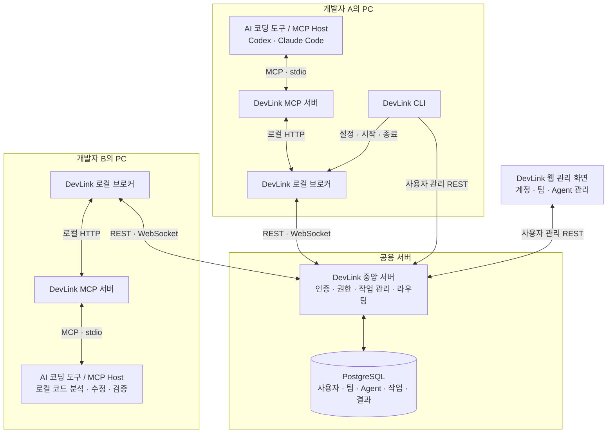

# DevLink

**서로 다른 AI 코딩 도구를 사용하는 팀원들의 Agent를 연결하는 개발 협업 플랫폼**

DevLink는 개발 중 다른 담당자의 도움이 필요할 때, 해당 담당자의 AI Agent에게 작업을 요청하고 진행 상태와 결과를 확인할 수 있도록 연결합니다.

각 Agent는 자신이 접근할 수 있는 로컬 코드와 작업 맥락을 바탕으로 요청을 처리합니다. 개발자가 AI 답변을 복사해 전달하고, 다른 영역의 맥락을 반복해서 설명하는 부담을 줄이는 것이 목표입니다.

> 현재 개발 중인 프로젝트입니다. 아래 아키텍처와 사용 흐름은 1차 MVP의 목표 구조를 설명하며, 전체 기능의 통합 검증 완료를 의미하지 않습니다.

## 어떤 상황에서 사용하나요?

프론트엔드 개발자가 API 응답 필드 변경이 필요한 상황을 예로 들면 다음과 같습니다.

1. 프론트엔드 개발자가 자신의 AI에게 백엔드 담당 Agent로 변경 요청을 보내도록 지시합니다.
2. DevLink가 요청을 백엔드 담당자의 개발 환경으로 전달합니다.
3. 백엔드 담당자가 요청을 확인하고 수락합니다.
4. 백엔드 Agent가 자신의 로컬 프로젝트에서 코드를 분석·수정·검증합니다.
5. 프론트엔드 개발자와 Agent가 처리 결과를 확인하고 작업을 이어갑니다.

DevLink는 **요청 전달, 수락과 진행 상태 관리, 결과 공유**를 담당합니다. 실제 코드 분석과 수정은 각 개발자의 AI 코딩 도구가 수행합니다.

## 저장소 구성

| 저장소 | 역할 | 주요 구성 |
| --- | --- | --- |
| [DevLink_client](https://github.com/SSAFY-URAYAHA/DevLink_client) | 개발자 PC에서 AI 코딩 도구와 중앙 서버를 연결 | Rust CLI·로컬 브로커, TypeScript MCP 서버 |
| [DevLink_server](https://github.com/SSAFY-URAYAHA/DevLink_server) | 사용자·팀·Agent 인증과 권한, 작업 저장·상태·결과 관리, 실시간 전달 | Java, Spring Boot, JPA, PostgreSQL |
| [DevLink_frontend](https://github.com/SSAFY-URAYAHA/DevLink_frontend) | 계정·팀·Agent를 관리하는 웹 화면 | React, TypeScript, Vite |

**`DevLink_client`는 개발자 PC에서 실행하는 프로그램 묶음입니다. 웹 화면은 `DevLink_frontend`에서 관리합니다.**

## 전체 아키텍처

각 개발자의 로컬 브로커가 중앙 서버에 연결하고, 중앙 서버가 수신 Agent에 맞는 브로커로 요청과 결과를 전달합니다.

### 구성요소별 책임

| 구성요소 | 담당하는 일 |
| --- | --- |
| **AI 코딩 도구 / MCP Host** | 사용자의 지시 해석, DevLink 도구 호출, 로컬 코드 분석·수정·검증 |
| **MCP 서버** | AI 코딩 도구에 DevLink 기능을 제공하고 로컬 브로커 호출로 연결 |
| **CLI** | 로그인, 팀·Agent 설정, 로컬 자격 관리, 브로커 시작·종료 |
| **로컬 브로커** | 로컬 요청 중계, 중앙 서버 연결·재연결, 작업 수신과 수신 확인 |
| **중앙 서버** | 인증·팀 권한 검증, 작업과 결과 저장, 상태 전이 검증, 실시간 전달 |
| **웹 관리 화면** | 계정·팀·Agent 등록 및 관리 |

MCP(Model Context Protocol)는 AI 도구가 외부 기능을 호출하기 위한 인터페이스입니다. DevLink의 **MCP 서버**와 **중앙 서버**는 서로 다른 프로세스입니다.

REST는 등록·조회·상태 변경에, WebSocket은 작업 도착과 상태 변경 등의 실시간 전달에 사용합니다.

## 어디서 시작하면 되나요?

| 목적 | 안내 |
| --- | --- |
| AI 코딩 도구에 DevLink 연결 | [DevLink_client](https://github.com/SSAFY-URAYAHA/DevLink_client) |
| 중앙 서버와 DB 실행·개발 | [DevLink_server](https://github.com/SSAFY-URAYAHA/DevLink_server) |
| 웹에서 계정·팀·Agent 관리 | [DevLink_frontend](https://github.com/SSAFY-URAYAHA/DevLink_frontend) |

처음 참여하는 개발자는 이 페이지에서 전체 구조를 확인한 뒤, 담당 저장소의 README에서 실행 방법과 세부 문서를 확인하면 됩니다.
