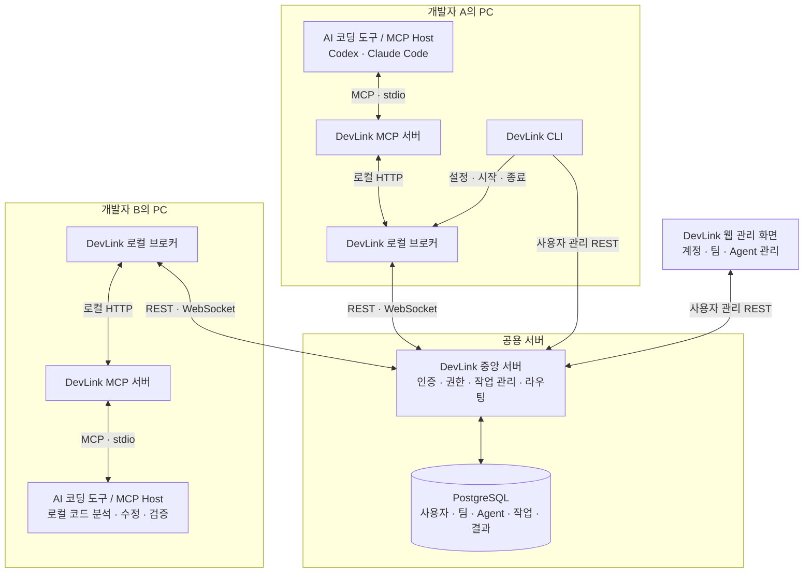
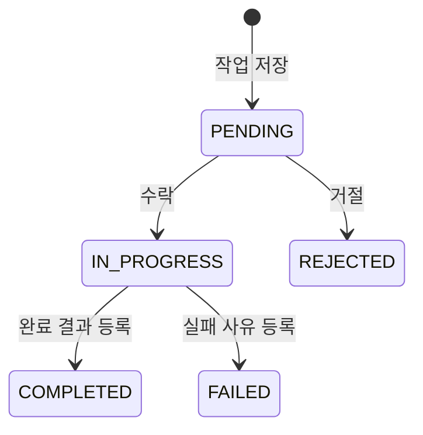

# DevLink

**서로 다른 AI 코딩 도구를 사용하는 팀원들의 Agent를 연결하는 개발 협업 플랫폼**

DevLink는 개발 중 다른 담당자의 도움이 필요할 때, 해당 담당자의 AI Agent에게 작업을 요청하고 진행 상태와 결과를 확인할 수 있도록 연결합니다.

각 Agent는 자신이 접근할 수 있는 로컬 코드와 작업 맥락을 바탕으로 요청을 처리합니다. 개발자가 AI 답변을 복사해 전달하고, 다른 영역의 맥락을 반복해서 설명하는 부담을 줄이는 것이 목표입니다.

> 현재 개발 중인 프로젝트입니다. 아래 아키텍처와 사용 흐름은 1차 MVP의 목표 구조를 설명하며, 전체 기능의 통합 검증 완료를 의미하지 않습니다.

## 어떤 상황에서 사용하나요?

프론트엔드 개발자가 API 응답 필드 변경이 필요한 상황을 예로 들면 다음과 같습니다.

1. 프론트엔드 개발자가 자신의 AI에게 백엔드 담당 Agent로 변경 요청을 보내도록 지시합니다.
2. DevLink가 요청을 백엔드 담당자의 개발 환경으로 전달합니다.
3. 백엔드 담당자가 요청을 확인하고 수락합니다.
4. 백엔드 Agent가 자신의 로컬 프로젝트에서 코드를 분석·수정·검증합니다.
5. 프론트엔드 개발자와 Agent가 처리 결과를 확인하고 작업을 이어갑니다.

DevLink는 **요청 전달, 수락과 진행 상태 관리, 결과 공유**를 담당합니다. 실제 코드 분석과 수정은 각 개발자의 AI 코딩 도구가 수행합니다.

## 저장소 구성

| 저장소 | 역할 | 주요 구성 |
| --- | --- | --- |
| [DevLink_client](https://github.com/SSAFY-URAYAHA/DevLink_client) | 개발자 PC에서 AI 코딩 도구와 중앙 서버를 연결 | Rust CLI·로컬 브로커, TypeScript MCP 서버 |
| [DevLink_server](https://github.com/SSAFY-URAYAHA/DevLink_server) | 사용자·팀·Agent 인증과 권한, 작업 저장·상태·결과 관리, 실시간 전달 | Java, Spring Boot, JPA, PostgreSQL |
| [DevLink_frontend](https://github.com/SSAFY-URAYAHA/DevLink_frontend) | 계정·팀·Agent를 관리하는 웹 화면 | React, TypeScript, Vite |

**`DevLink_client`는 개발자 PC에서 실행하는 프로그램 묶음입니다. 웹 화면은 `DevLink_frontend`에서 관리합니다.**

## 전체 아키텍처

각 개발자의 로컬 브로커가 중앙 서버에 연결하고, 중앙 서버가 수신 Agent에 맞는 브로커로 요청과 결과를 전달합니다.

### 구성요소별 책임

| 구성요소 | 담당하는 일 |
| --- | --- |
| **AI 코딩 도구 / MCP Host** | 사용자의 지시 해석, DevLink 도구 호출, 로컬 코드 분석·수정·검증 |
| **MCP 서버** | AI 코딩 도구에 DevLink 기능을 제공하고 로컬 브로커 호출로 연결 |
| **CLI** | 로그인, 팀·Agent 설정, 로컬 자격 관리, 브로커 시작·종료 |
| **로컬 브로커** | 로컬 요청 중계, 중앙 서버 연결·재연결, 작업 수신과 수신 확인 |
| **중앙 서버** | 인증·팀 권한 검증, 작업과 결과 저장, 상태 전이 검증, 실시간 전달 |
| **웹 관리 화면** | 계정·팀·Agent 등록 및 관리 |

MCP(Model Context Protocol)는 AI 도구가 외부 기능을 호출하기 위한 인터페이스입니다. DevLink의 **MCP 서버**와 **중앙 서버**는 서로 다른 프로세스입니다.

REST는 등록·조회·상태 변경에, WebSocket은 작업 도착과 상태 변경 등의 실시간 전달에 사용합니다.

## 사용 흐름

### 1. 협업 환경 준비

- 사용자 계정을 만들고 같은 팀에 참여합니다.
- 각자의 AI 코딩 도구에 대응하는 Agent를 등록합니다.
- CLI에서 Agent와 로컬 프로젝트를 설정하고 브로커를 실행합니다.
- AI 코딩 도구에 DevLink MCP 서버를 연결합니다.

웹 화면과 CLI는 계정·팀·Agent 준비를 위한 진입점입니다. AI 도구의 작업 요청은 MCP와 로컬 브로커를 통해 전달됩니다.

### 2. 상대 Agent에게 작업 요청

- 사용자가 요청 내용과 수신 Agent를 지정합니다.
- 요청 Agent가 `create_task`를 호출합니다.
- 중앙 서버가 요청과 권한을 검증하고 작업을 저장한 뒤 수신 브로커로 전달합니다.
- 수신 브로커는 요청을 저장하고 수신 확인(ACK)을 보냅니다.

1차 MVP에서는 요청자가 수신 Agent를 직접 지정합니다.

### 3. 요청 확인과 수락

- 수신자가 요청 내용과 작업 범위를 확인합니다.
- 사용자의 수락 지시에 따라 수신 Agent가 작업 상태를 변경합니다.
- 수락한 작업은 `PENDING`에서 `IN_PROGRESS`로 전환됩니다.

**브로커의 수신 확인과 사용자의 작업 수락은 다릅니다.** 요청을 수신했다는 사실만으로 AI가 코드 수정을 시작하는 것은 아닙니다.

### 4. 로컬 작업과 결과 등록

- 수신 Agent가 자신의 로컬 프로젝트에서 코드를 분석하고 수정합니다.
- 수정 내용을 검증하고 결과 요약·변경 파일·검증 결과를 등록합니다.
- 작업을 완료하지 못한 경우 실패 사유를 등록합니다.

### 5. 결과 확인과 후속 작업

- 요청자는 알림이나 조회를 통해 진행 상태와 결과를 확인합니다.
- 변경 내용과 검증 결과를 바탕으로 자신의 작업을 이어갑니다.

## 설계에서 중요하게 보는 점

- **각자의 개발 환경에서 작업합니다.** 실제 파일 수정은 해당 프로젝트에 접근할 수 있는 로컬 AI 도구가 수행합니다.
- **중앙 서버가 공유 상태의 기준입니다.** 팀 권한, 작업 상태와 결과를 중앙에서 관리합니다.
- **저장·전달·수락·완료를 구분합니다.** 요청이 저장되거나 브로커에 전달됐다는 사실만으로 작업 완료로 처리하지 않습니다.
- **사용자 인증과 Agent 인증을 구분합니다.** 계정·팀 관리에 사용하는 사용자 자격과 Agent의 업무·연결 자격은 용도가 다릅니다.

## MVP 범위와 확장 방향

1차 MVP는 **사용자가 지정한 상대 Agent에게 작업을 요청하고, 수락 후 로컬에서 수정한 결과를 확인하는 흐름**에 집중합니다.

| 구분 | 범위 |
| --- | --- |
| 1차 MVP 목표 | 사용자·팀·Agent 준비, 수신자 지정, 작업 전달, 수락·상태 관리, 로컬 코드 수정, 결과 등록·조회 |
| 향후 확장 방향 | Agent 등록 과정 간소화, 담당 Agent 자동 탐색, 다중 Agent 협업, GitHub·Jira 등 업무 도구 연동 |

구성요소별 구현 상태와 실제 연동 가능 범위는 각 저장소의 README와 검증 문서를 확인해 주세요.

## 어디서 시작하면 되나요?

| 목적 | 안내 |
| --- | --- |
| AI 코딩 도구에 DevLink 연결 | [DevLink_client](https://github.com/SSAFY-URAYAHA/DevLink_client) |
| 중앙 서버와 DB 실행·개발 | [DevLink_server](https://github.com/SSAFY-URAYAHA/DevLink_server) |
| 웹에서 계정·팀·Agent 관리 | [DevLink_frontend](https://github.com/SSAFY-URAYAHA/DevLink_frontend) |

처음 참여하는 개발자는 이 페이지에서 전체 구조를 확인한 뒤, 담당 저장소의 README에서 실행 방법과 세부 문서를 확인하면 됩니다.
